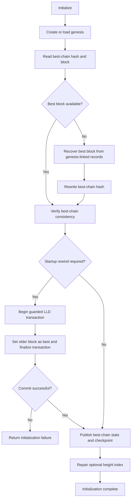

# `src/TAO/Ledger/chainstate.cpp`

`ChainState` maintains the in-memory view of the best chain and initializes it
from the ledger database at startup. `Initialize()` loads or repairs the best
block, checks chain consistency, applies configured startup rewinds, and then
rebuilds checkpoint and height-index state.

## Startup flow

The hardcoded-checkpoint recovery path is enabled only for mainnet mode. The
`-revertblocks` option can request an additional rewind. Both rewind paths use
an LLD transaction guard because `SetBest()` may commit its transaction
internally; the caller commits only if the transaction remains open. If the
rewind's begin or final commit fails, initialization returns failure rather
than starting with the unreverted chain state.

## State published during initialization

After startup rewinds complete, the best block's height and trust are copied to
the chainstate counters, and the active checkpoint hash is set from that block.
Checkpoint history and, when requested, the height index are then restored from
the ledger database.
