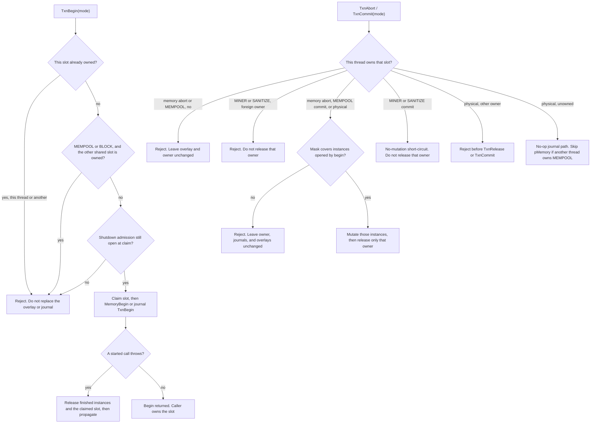
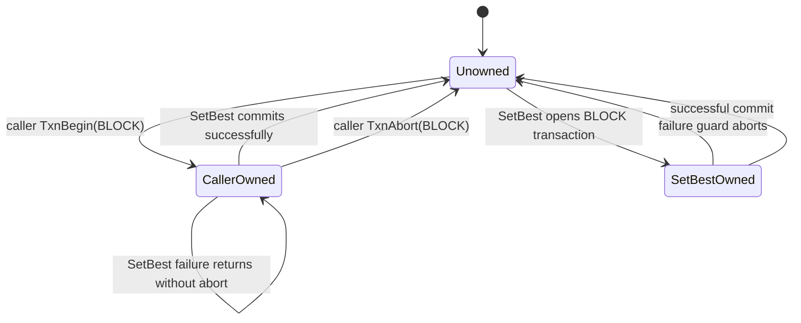

# LLD global transaction ownership

NODE5 does not use a cross-mode coordinator. `pMiner`, `pSanitize`, and the physical journal are process-wide, so MINER, SANITIZE, and the physical journal each have an owner slot. MINER and SANITIZE can stay open beside MEMPOOL. A slot mutex is held only across that slot's mutation. Shared-overlay checks lock the MEMPOOL slot before the physical slot.

`MemoryBegin` maps every flag other than MINER and SANITIZE onto the same process-wide `pMemory`. That includes `FLAGS::MEMPOOL` and physical `FLAGS::BLOCK`. Those two modes therefore share one overlay even though they have separate owner slots. `TxnBegin` rejects the second begin, whether it comes from another thread or the same thread, before `MemoryBegin`. A duplicate begin of a slot that is already owned, including by the calling thread, is rejected the same way. A rejected begin does not replace the overlay or open the physical journal.

`TritiumBlock::Accept()` must not call `mempool.ProcessOrphans(hashProducer)` while its physical `BLOCK` guard is armed. That routine accepts each orphan through `TxnBegin(FLAGS::MEMPOOL)`, which this rule rejects, so the orphan would stay queued. Producer writes stay in the open block transaction through `Index()` / `SetBest()`. After that transaction is committed and `TransactionGuard::Release()` has run, Accept processes producer orphans only when disk `ReadLast` for the producer genesis is the producer. A stored side chain has not connected, so its orphans stay queued instead of being recorded as a false conflict.

MINER and SANITIZE `TxnCommit` stays a no-mutation short-circuit. It returns true when this thread owns that mode or owns nothing. It returns false when another thread owns that slot (a foreign owner), and when this thread owns a different mode but not this slot. Neither rejection releases an owner.

A physical commit applies the BLOCK-created `pMemory` only when this thread owns the physical slot and no other thread owns MEMPOOL. It does not commit or delete an overlay owned by another thread. Begin-time rejection is what keeps those two owners from being created together.

The stored begin mask is part of that ownership. An owned memory abort, a MEMPOOL commit, and an owned physical commit or abort must cover every instance that begin opened. A narrower mask is rejected before `MemoryCommit`, `MemoryRelease`, `TxnCommit`, or `TxnRelease`, and the owner stays claimed. A wider mask is accepted, but extra caller mask bits are ignored: operations apply only to the instances opened by begin. MINER and SANITIZE commit stay a no-mutation short-circuit and do not release that owner, so a narrower mask there cannot drop the slot. An unowned physical abort does not use this check; that path is still recovery.

If `MemoryBegin` or a selected journal `TxnBegin` throws after the slot is claimed, `TxnBegin` releases only the instances whose begin call returned, then clears that slot, and then propagates the exception. The throwing call is not released: those begin methods allocate the replacement before deleting the previous pointer, so a failed allocation leaves that instance unchanged. `TxnRelease` is not applied to a journal this begin did not open, because that call truncates `journal.dat`. A caller catch runs only after this rollback. It must not abort a begin that did not return, and a flag set only after `TxnBegin` returns cannot see the failed begin.

The final shutdown-admission check and owned-slot count happen together under the lifetime mutex when claiming: if shutdown begins first, a waiting begin is rejected without claiming a slot; if the claim wins first, shutdown waits for it to finish.

`TransactionGuard` also covers physical begins whose caller returns through an exception instead of `debug::abort`. That is `ActivateCandidateBestChain()` when it opened the journal, each client MERKLE handler in `LLP/tritium.cpp` and `LLP/lookup.cpp`, and `TritiumBlock::Accept()`. The guard is released only after commit. `SetBest()` uses a separate self-owned guard so a throw aborts the journal it opened and does not abort an outer BLOCK owner. Diagrams: [Process.cpp](process-cpp.md), [State.cpp](state-cpp.md), [Tritium.cpp](tritium-cpp.md).

Disposable SANITIZE and MINER work uses `TransactionGuard` so the overlay is aborted if the thread still owns it when the guard is destroyed. That includes `Notifications::SanitizeContract`, each `SanitizeUnconfirmed` transaction, `Mempool::Check`'s sanitize probe, `CheckContract`, and the Tritium half of `AddTransactions`. `AddTransactions` disarms the guard and aborts before the legacy `Connect(FLAGS::MINER)` loop, so that loop does not run inside the Tritium overlay. An exception from `Verify` or `Connect` skips the disarm and the guard aborts on unwind. `Mempool::Check` ends the sanitize guard before it begins the MEMPOOL disconnect transaction. The disconnect explicitly aborts when `Disconnect` fails, then removes the entry. Unexpected exceptions otherwise abort by default. If API-session `Delete()` throws after `Remove()` successfully erased the transaction from the pool maps, the corresponding disconnect is committed before rethrowing; exceptions before that successful removal do not commit partial overlay changes.
