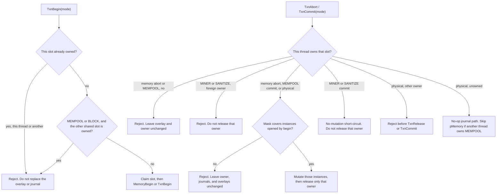

# LLD global transaction ownership

NODE5 does not use a cross-mode coordinator. `pMiner`, `pSanitize`, and the physical journal are process-wide, so MINER, SANITIZE, and the physical journal each have an owner slot. MINER and SANITIZE can stay open beside MEMPOOL. A slot mutex is held only across that slot's mutation. Shared-overlay checks lock the MEMPOOL slot before the physical slot.

`MemoryBegin` maps every flag other than MINER and SANITIZE onto the same process-wide `pMemory`. That includes `FLAGS::MEMPOOL` and physical `FLAGS::BLOCK`. Those two modes therefore share one overlay even though they have separate owner slots. `TxnBegin` rejects the second begin, whether it comes from another thread or the same thread, before `MemoryBegin`. A duplicate begin of a slot that is already owned, including by the calling thread, is rejected the same way. A rejected begin does not replace the overlay or open the physical journal.

`TritiumBlock::Accept()` must not call `mempool.ProcessOrphans(hashProducer)` while its physical `BLOCK` guard is armed. That routine accepts each orphan through `TxnBegin(FLAGS::MEMPOOL)`, which this rule rejects, so the orphan would stay queued. Producer writes stay in the open block transaction through `Index()` / `SetBest()`. After that transaction is committed and `TransactionGuard::Release()` has run, Accept processes producer orphans only when disk `ReadLast` for the producer genesis is the producer. A stored side chain has not connected, so its orphans stay queued instead of being recorded as a false conflict.

MINER and SANITIZE `TxnCommit` stays a no-mutation short-circuit. It returns true when this thread owns that mode or owns nothing. It returns false when another thread owns that slot (a foreign owner), and when this thread owns a different mode but not this slot. Neither rejection releases an owner.

A physical commit applies the BLOCK-created `pMemory` only when this thread owns the physical slot and no other thread owns MEMPOOL. It does not commit or delete an overlay owned by another thread. Begin-time rejection is what keeps those two owners from being created together.

The stored begin mask is part of that ownership. An owned memory abort, a MEMPOOL commit, and an owned physical commit or abort must cover every instance that begin opened. A narrower mask is rejected before `MemoryCommit`, `MemoryRelease`, `TxnCommit`, or `TxnRelease`, and the owner stays claimed. A wider mask is not a subset: it still applies to every opened instance, which is what lets a commit aggregate an extra instance that was never begun. MINER and SANITIZE commit stay a no-mutation short-circuit and do not release that owner, so a narrower mask there cannot drop the slot. An unowned physical abort does not use this check; that path is still recovery.
