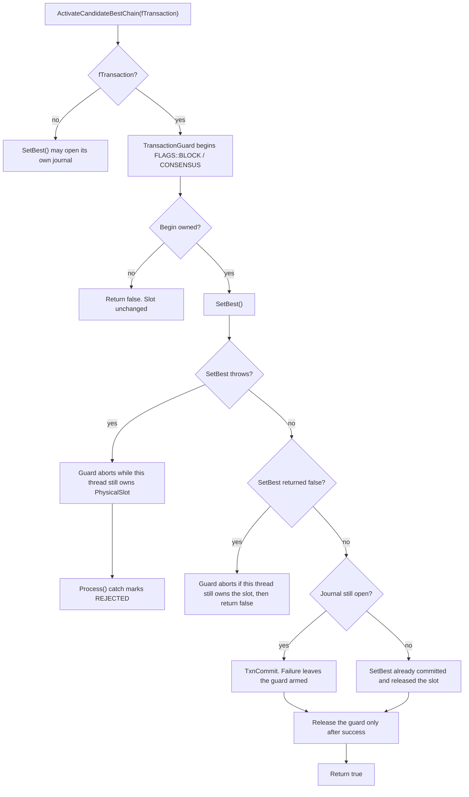

# Process.cpp

`src/TAO/Ledger/process.cpp` accepts network blocks and activates a heavier candidate through `ActivateCandidateBestChain()`. That function is the only production caller that opens a physical `FLAGS::BLOCK` transaction and then calls `SetBest()`.

`Process()` catches exceptions from that path and marks the block `REJECTED`. The activation transaction must not stay owned when that catch returns, or the process-wide `PhysicalSlot` stays claimed by the processing thread.

## Candidate activation transaction

`SetBest()` treats an open journal owned by this thread as an outer transaction and commits it internally. The guard is released only after that success path. On failure or exception, the guard aborts only if this thread still owns the slot; `SetBest()` may already have aborted and released it before returning false, so the caller must not issue an unconditional abort.

Sibling documents: [State.cpp](state-cpp.md), [Tritium.cpp](tritium-cpp.md), [LLD global transactions](lld-global-transactions.md).
