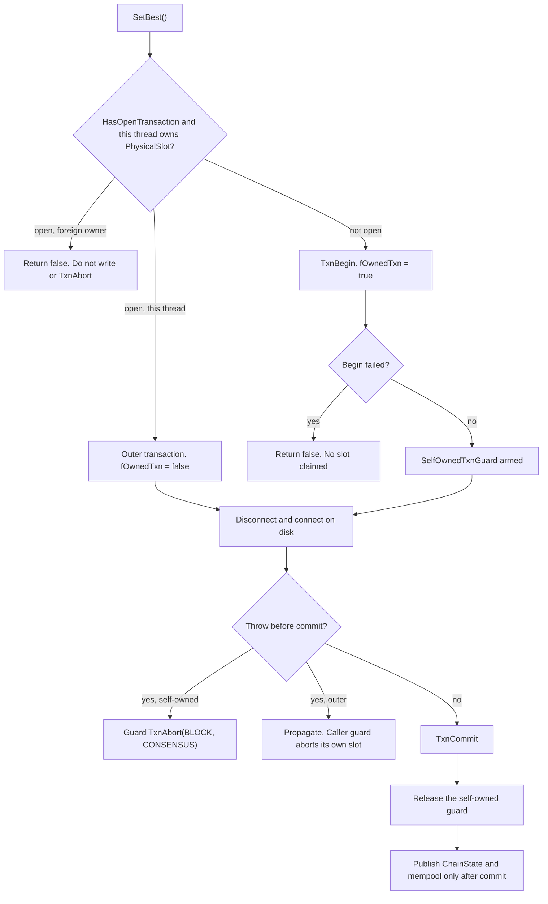

# State.cpp

`src/TAO/Ledger/state.cpp` implements `BlockState::SetBest()`. Callers that already hold a physical `FLAGS::BLOCK` transaction (`TritiumBlock::Accept()`, `LegacyBlock::Accept()`, and checkpoint rewind) keep that outer owner. A standalone caller has no journal, so `SetBest()` opens one and must release it on every exit, including a throw from `Connect()` or `Disconnect()`.

## Self-owned versus outer transaction



The guard checks `ThreadOwnsTransaction(FLAGS::BLOCK)` before aborting. After a successful commit the physical slot is already released, so a later post-commit throw does not abort a transaction `SetBest()` no longer owns. An outer transaction is never aborted by this guard.

## Failure inside an outer transaction

```mermaid
sequenceDiagram
    participant Caller
    participant LLD
    participant SetBest
    Caller->>LLD: TxnBegin(BLOCK)
    LLD-->>Caller: caller owns the journal
    Caller->>SetBest: SetBest()
    SetBest->>SetBest: A lookup, disconnect, connect, or debug read fails
    SetBest-->>Caller: Return false; self-owned guard does not abort
    Note over Caller,LLD: The outer transaction remains open
    Caller->>LLD: TxnAbort(BLOCK)
    LLD-->>Caller: Roll back and release caller's transaction
```

The same failure returns through the guard when `SetBest()` opened the journal itself; in that case the guard aborts it before returning.

Sibling documents: [Process.cpp](process-cpp.md), [Tritium.cpp](tritium-cpp.md), [LLD global transactions](lld-global-transactions.md).
