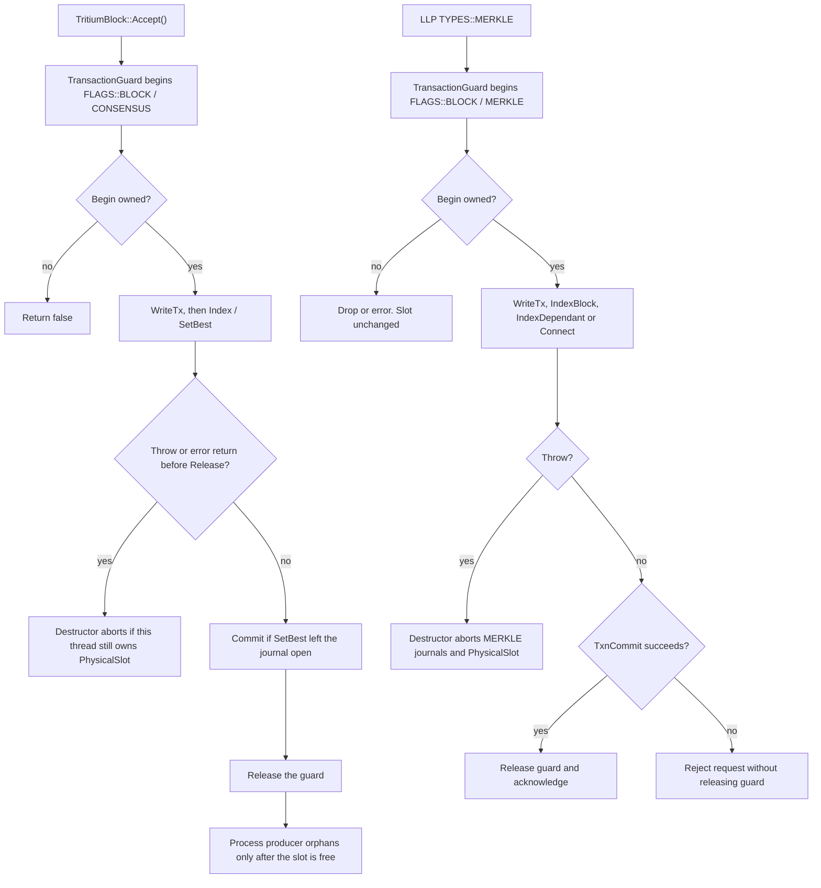

# Tritium.cpp

Two Tritium translation units open physical transactions that must not outlive an exception.

- `src/TAO/Ledger/tritium.cpp` — `TritiumBlock::Accept()` writes the block and may activate it through `SetBest()`.
- `src/LLP/tritium.cpp` — the client `TYPES::MERKLE` handler indexes a merkle transaction on a long-lived network thread.

## Accept and merkle indexing

`Accept()` must not process producer orphans while the block guard is armed. MEMPOOL and BLOCK share `pMemory`, so `TxnBegin(FLAGS::MEMPOOL)` is rejected until `Release()`. The LLP merkle handler is the same rule on `INSTANCES::MERKLE`: `IndexDependant` or a database call can throw after begin, and a persistent network thread would otherwise keep `PhysicalSlot` forever.

Both MERKLE handlers reject a request when `TxnCommit()` reports failure and do not log it as accepted. The guard is released only after a successful commit; LLD releases its physical owner as part of commit cleanup even when one of the selected database commits fails.

The lookup server uses the same MERKLE guard in `src/LLP/lookup.cpp`.

Sibling documents: [Process.cpp](process-cpp.md), [State.cpp](state-cpp.md), [LLD global transactions](lld-global-transactions.md).
